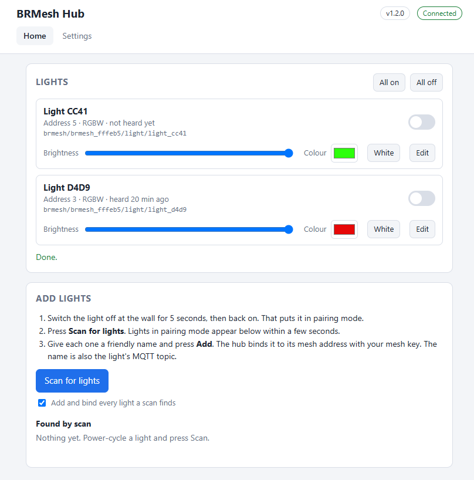
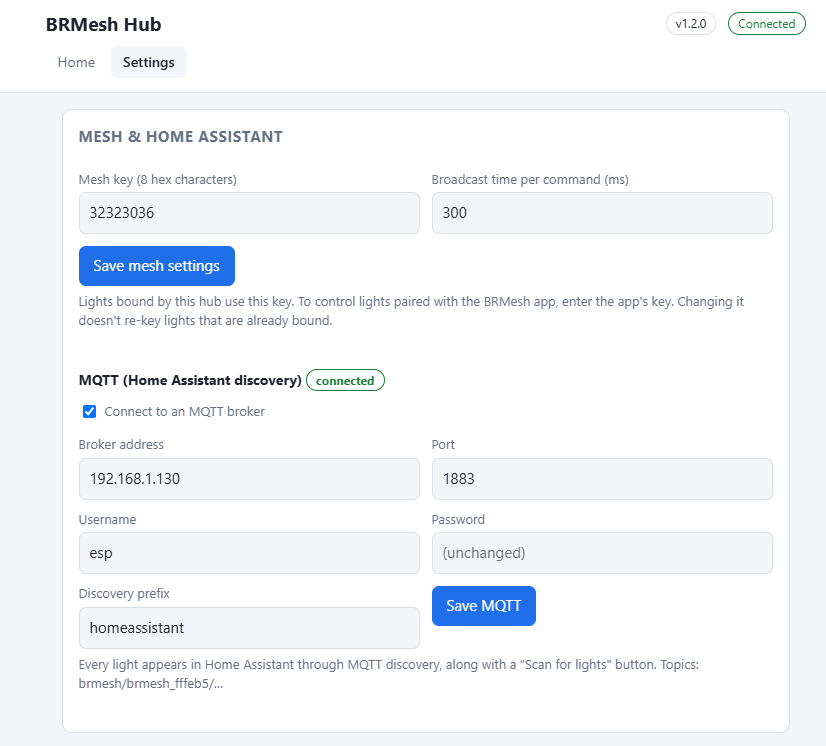
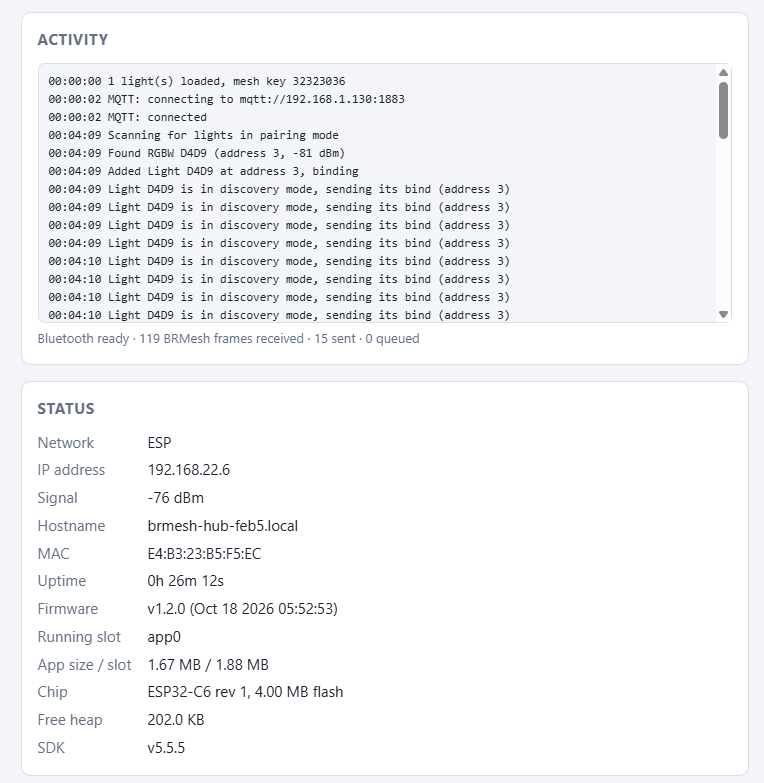
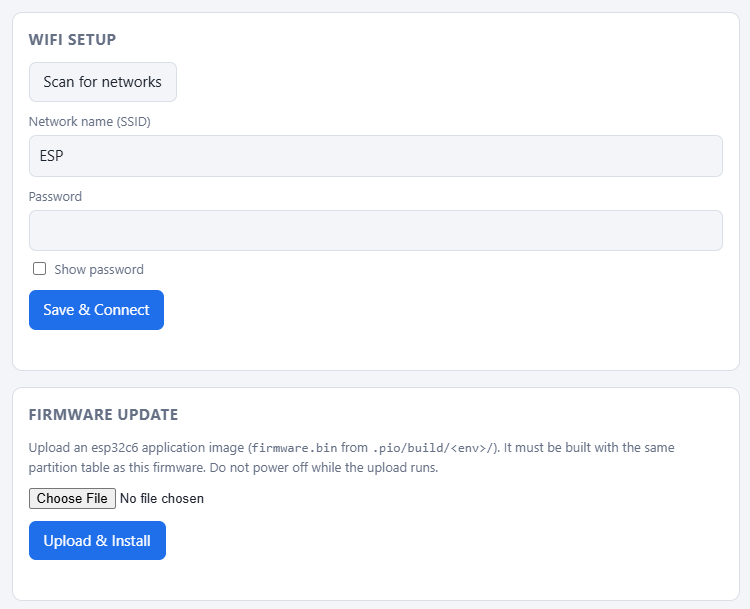
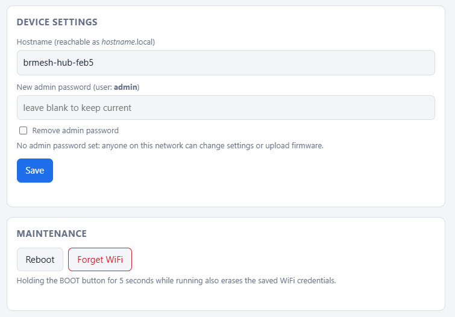

# BRMesh Hub

**Standalone ESP32-C6 / ESP32-C3 firmware for BRMesh / Broadlink "Fastcon" Bluetooth lights.**
It finds lights, adds them to your mesh, and controls them from a built-in web page, from Home
Assistant over MQTT, or through a REST API. You don't need ESPHome or the phone app.

[](LICENSE)


<p align="center">
  
</p>

## Features

- **Finds new lights.** **Scan for lights** broadcasts the Fastcon scan command. Lights in pairing
  mode answer with their device ID, type and key.
- **Adds them to your mesh.** **Add** binds a light to a mesh address and your mesh key. A
  heartbeat from the new address confirms the bind. You can also have every light a scan finds added
  automatically.
- **Controls them:** on/off, brightness, RGB colour, white and colour temperature, depending on the
  light type.
- **Gives each light a friendly name** that is also its MQTT topic: **Porch Light** →
  `brmesh/<node>/light/porch_light`.
- **Home Assistant over MQTT.** Each light is announced through MQTT discovery (JSON schema), along
  with a hub device that has a **Scan for lights** button.
- **REST API** with JSON bodies for scripts and other systems. See [docs/API.md](docs/API.md).
- **Setup without other tools.** The hub has a setup access point with a captive portal, WiFi setup, an
  admin password, firmware updates from the browser, and mDNS (`brmesh-hub-xxxx.local`).

It replaces the ESPHome `brmesh-hub` config built on
[dennispg/esphome-fastcon](https://github.com/dennispg/esphome-fastcon), and it can add new lights to
the mesh, which that component can't.

## Hardware

| Board | Environment | USB port for flashing and the log |
| --- | --- | --- |
| ESP32-C6 (for example ESP32-C6-DevKitC-1) | `esp32c6` | Either port. The log goes to the **UART** port |
| ESP32-C3 wired to the chip's own USB port | `esp32c3` | The chip's USB port (USB-Serial/JTAG) |

Any module with 4 MB of flash or more works. Both chips have the Bluetooth 5 LE radio the lights need.

## Build and flash

The project uses [PlatformIO](https://platformio.org/) with the
[pioarduino](https://github.com/pioarduino/platform-espressif32) platform (Arduino core 3.3.11, ESP-IDF
5.5). It is needed because Arduino 2.x doesn't support the C6. Its Bluetooth stack is NimBLE, which
this firmware drives directly.

```sh
pio run -e esp32c6 -t upload    # ESP32-C6
pio run -e esp32c3 -t upload    # ESP32-C3 on its own USB port
pio device monitor              # 115200 baud; press Enter for a status summary
```

Add `--upload-port COMx` (or `/dev/ttyUSBx`) to pick the port.

- **First flash** must go over USB. After that, upload `.pio/build/<env>/firmware.bin` from the
  **Firmware Update** card. It must be built for the same chip.
- **Blank chip, any flashing tool:** write `.pio/build/<env>/firmware.factory.bin` at offset `0x0`:

  ```sh
  esptool.py --chip esp32c6 write_flash 0x0 firmware.factory.bin
  ```

- **Boards using the chip's own USB port:** the boot log is gone before the port reconnects. Press
  Enter in the serial monitor to print the status (WiFi, Bluetooth, lights, MQTT) and the recent
  activity log. The C3 environment resets with the watchdog after flashing, because the usual RTS
  reset leaves these boards in download mode.

## First use

1. With no saved WiFi, the hub opens the open access point **BRMesh-Hub-XXXX**. Join it and the setup
   page opens. Choose your network under **Settings → WiFi Setup**.
2. Open `http://brmesh-hub-xxxx.local/`, or the IP address from your router.
3. Under **Settings → Mesh & Home Assistant**, check the mesh key. To control lights paired with the
   BRMesh app, enter the app's key.
4. Set an admin password under **Settings → Device Settings**.

## Adding lights

1. Switch the light off at the wall for 5 seconds, then on again. Lights only accept a bind in pairing
   mode, which they enter after a power cycle. A scan alone doesn't put them in it.
2. On the **Home** tab, press **Scan for lights**. Each light in pairing mode appears under **Found by
   scan**, with its type, signal and current address.
3. Give it a friendly name, check the suggested address and press **Add**. Below the name box, the
   page shows the MQTT topic the name gives. The light shows *waiting for the light to confirm the
   bind* until its first heartbeat from the new address.
4. If the bind doesn't take, switch the light off and on again. The hub re-sends the pending bind as
   soon as the light announces itself.

With **Add and bind every light a scan finds** checked, step 3 happens automatically. A light that
already has a free address, for example from the app, keeps it. Lights already paired with the
BRMesh app are added the same way.

Each light card has controls for what the light supports, which comes from the type it reports in
the scan. **Edit** renames the light, changes its address (which re-binds it), binds it again, or
removes it.

## Settings

The **Settings** tab holds everything that isn't day-to-day light control.

<p align="center">
  
</p>

| Setting | Default | Notes |
| --- | --- | --- |
| Mesh key | `32323035` | 4 bytes, hex. Encrypts light commands and is given to lights at bind. Changing it doesn't re-key lights that are already bound |
| Broadcast time per command | 300 ms | How long each light command is advertised. Raise it if far-away lights miss commands |
| Add and bind every light a scan finds | off | On the **Home** tab |

The **Activity** log shows scans, binds, heartbeats and MQTT events as they happen. **Status** shows
the network, firmware, flash slot and memory.

<p align="center">
  
</p>

**WiFi Setup** scans for networks and saves the credentials. **Firmware Update** installs a new
`firmware.bin` from the browser.

<p align="center">
  
</p>

**Device Settings** sets the hostname and the admin password. With a password set, the web page and
every API route need HTTP Basic auth with user `admin`. **Maintenance** reboots the hub or erases the
WiFi credentials. Holding the BOOT button for 5 seconds also erases them.

<p align="center">
  
</p>

## Home Assistant (MQTT)

Enable MQTT under **Settings → Mesh & Home Assistant**. You need an MQTT broker, such as the Mosquitto
add-on, and the MQTT integration in Home Assistant. Lights then appear automatically. The node ID is
`brmesh_` plus the last 6 hex digits of the MAC.

| Topic | Use |
| --- | --- |
| `brmesh/<node>/status` | `online` / `offline` (retained, last will) |
| `brmesh/<node>/light/<name>/set` | JSON commands from Home Assistant |
| `brmesh/<node>/light/<name>/state` | Assumed state (retained) |
| `brmesh/<node>/scan` | Any message starts a scan |
| `<prefix>/light/<node>/<device ID>/config` | Discovery, one per light |
| `<prefix>/button/<node>/scan/config` | Discovery for the scan button |

`<name>` is the light's friendly name as a topic: lower case, with every run of other characters
turned into `_`. **Porch Light** becomes `porch_light`. Names must give distinct topics.

- **Renaming** a light moves its topics and clears the retained state under the old name. Home
  Assistant keeps the same entity, because discovery and the unique ID use the device ID, which never
  changes.
- **Old topic:** commands sent to `brmesh/<node>/light/<device ID>/set` still work.
- **Home Assistant restarts** (`<prefix>/status` = `online`): the hub publishes discovery again.
- **Removing** a light clears its retained topics.

Commands use the Home Assistant JSON schema:

```json
{"state": "ON", "brightness": 180, "color": {"r": 255, "g": 120, "b": 0}}
```

## REST API

There's a JSON API at `/api/v1` for scripts and other systems. The full reference, with curl, Python and
PowerShell examples, is in **[docs/API.md](docs/API.md)**.

```sh
# List lights
curl http://brmesh-hub-xxxx.local/api/v1/lights

# Porch light on, half brightness, warm white
curl -X PUT -H 'Content-Type: application/json' \
  -d '{"on": true, "brightness": 128, "color_temp_kelvin": 2700}' \
  "http://brmesh-hub-xxxx.local/api/v1/lights/Porch%20Light/state"

# Everything off
curl -X PUT -H 'Content-Type: application/json' -d '{"on": false}' \
  http://brmesh-hub-xxxx.local/api/v1/lights/all/state
```

| Method | Path | Does |
| --- | --- | --- |
| GET | `/api/v1` | Hub info and status |
| GET, POST | `/api/v1/lights` | List lights / add a discovered light |
| GET, PUT, DELETE | `/api/v1/lights/{light}` | Get, rename or re-address, remove |
| GET, PUT | `/api/v1/lights/{light}/state` | Read or change state (`{light}` = id, name, address or `all`) |
| POST | `/api/v1/lights/{light}/bind` | Send the bind again |
| POST | `/api/v1/scan` | Scan for lights in pairing mode |
| GET | `/api/v1/discovered` | Lights found by scans |
| GET, PUT | `/api/v1/settings` | Mesh key, broadcast time, auto-add |
| GET | `/api/v1/log` | Activity log |

The web page uses its own form-encoded routes under `/api/mesh/*`, and the base firmware has
`/api/status`, `/api/scan`, `/api/wifi`, `/api/device`, `/api/reboot`, `/api/forget` and `/update`.
These may change between versions. Use `/api/v1` for integrations.

## How it works

| File | Contents |
| --- | --- |
| `src/Fastcon.*` | Protocol: frame building, encryption, whitening, CRC, discovery and heartbeat parsing. No Arduino dependencies |
| `src/MeshRadio.*` | NimBLE: continuous passive scan for company ID `0xFFF0`, and one non-connectable advertisement at a time |
| `src/MeshHub.*` | Light list (NVS namespace `brmesh`), discovery, binding, transmit queue, settings, activity log |
| `src/MeshMqtt.*` | MQTT discovery and commands (ESP-IDF MQTT client) |
| `src/MeshApi.*` | `/api/v1/*` REST API |
| `src/MeshWeb.*` | `/api/mesh/*` routes for the web page |
| `src/MeshPage.h` | The BRMesh cards and script, injected into the base page (`data-page="settings"` puts a card on the Settings tab) |
| `lib/BaseCore` | Base firmware: WiFi and setup AP, captive portal, web server, admin password, firmware updates, Home / Settings tabs |
| `tools/fastcon_selftest.cpp` | Host test of the protocol code against reference frames |
| `docs/API.md` | REST API reference |

Scans are broadcast for 2.5 s and binds for 1.5 s. One frame is on air at a time. If several commands
for the same light queue up while another frame is on air, they are merged, so the latest slider
value wins.

Protocol self-test on a desktop compiler:

```sh
c++ -std=c++17 -I src tools/fastcon_selftest.cpp src/Fastcon.cpp -o fastcon_selftest && ./fastcon_selftest
```

### Protocol notes

- Everything is a legacy BLE advertisement: flags `02 01 02`, then manufacturer data `FF F0 FF` + a
  24-byte whitened RF frame. Lights don't use GATT.
- Body header byte 0 holds forward (bit 7), type (bits 4-6) and address high bits (0-3). The types
  are 0 scan, 1 discovery, 2 bind, 3 heartbeat, and 5 control.
- **Bind** (type 2) is encrypted with the light's own key from its discovery broadcast. Its data is
  `DID(6) + address + 0x01 + mesh key(4)`.
- **Control** (type 5, forward bit set, so lights relay it) is encrypted with the mesh key. Its data is
  `2 | (len+1) << 4`, address, then the command.
- Light commands are `00` (off), `80|level` (on, level 1-127), or 6 bytes:
  `80|level, blue, red, green, warm, cold`. RGB is normalised so the channels add up to 255.
- All lights advertise from `11:22:33:44:55:66`, so the scan runs with duplicate filtering off.

## Known limitations

- **Hardware testing:** discovery and binding have been tested with RGBW lights on an ESP32-C6.
  Other light types and the C3 build haven't been tested on hardware yet.
- **Colour temperature** uses the warm/cold bytes captured from the app's group commands. For single
  CCT lights that is a best guess.
- **Assumed state:** lights don't report their state or acknowledge commands, so the hub shows what
  it last sent. A light that misses a command stays out of step until the next one.
- **No unbind:** the protocol has no unbind command. Removing a light from the hub leaves its address
  and key on the light.
- **Flash space:** the app takes 1.67 MB (C6) / 1.51 MB (C3) of the 1.9 MB firmware slot.

## Credits

- Moody's reverse-engineering of the protocol: [MoodyAPI](https://github.com/moodyhunter/MoodyAPI)
- [dennispg/esphome-fastcon](https://github.com/dennispg/esphome-fastcon)
- [stromaa00/fastConLight](https://github.com/stromaa00/fastConLight): discovery, bind and heartbeat
  formats
- [ericgu08/esphome-fastcon](https://github.com/ericgu08/esphome-fastcon): cold/warm byte order

## License

[MIT](LICENSE)
